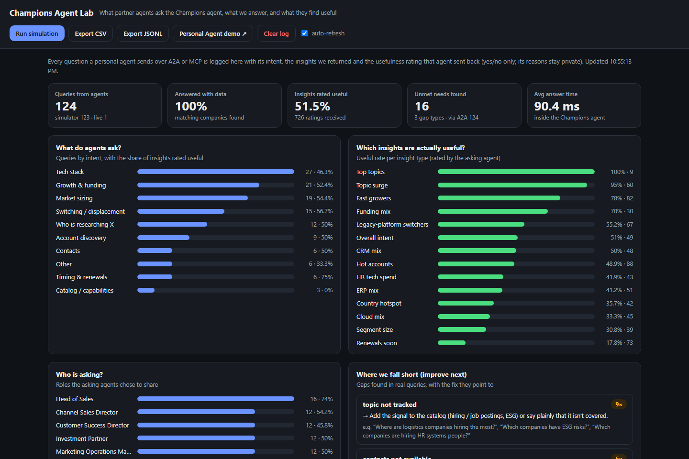
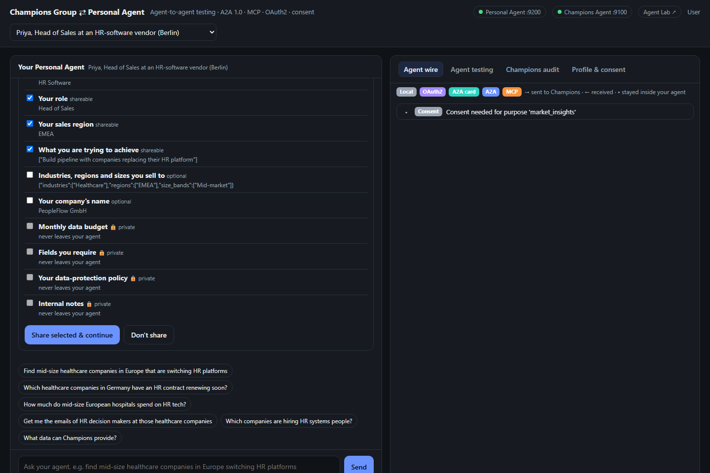
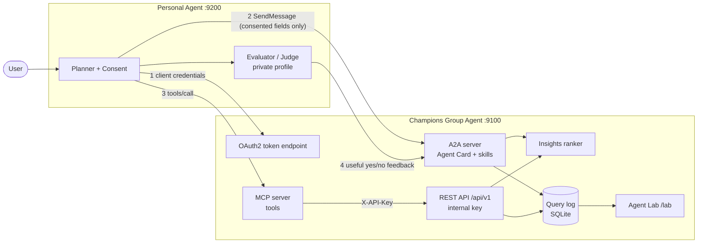

# Champions Group ⇄ Personal Agent

**A working agent-to-agent (A2A) demo.** A user's *Personal Agent* talks to the *Champions Group Agent* over open protocols (A2A 1.0, MCP and OAuth 2.0). It asks for the user's consent before sharing anything and returns personalised data insights. The **Agent Lab** shows what agents ask, which answers they find useful, and where the data offering falls short.


| Agent Lab: what agents ask and what they find useful | Personal Agent: consent before anything is shared |
|---|---|
|  |  |

---

## Why this exists

Buyers will soon send **their own AI agents** to talk to data providers. This project models that future and answers four practical questions:

1. **Can the Champions agent find insights that matter to a specific person?** Yes. It ranks about 12 insight types against the role and goals the person chose to share, and explains each one with a *"why for you"* line.
2. **What do agents actually ask?** Every query is logged with its intent, filters, results and latency.
3. **Which answers are useful?** The Personal Agent judges each insight privately, against budget, notes and must-have fields. It sends back only a yes/no rating, never its reasons.
4. **How do we improve?** Real queries are kept. Gaps (topics we don't track, contact requests, vague asks) are surfaced with a suggested fix and can be exported as CSV or JSONL.

It also shows a key architecture point: **MCP wraps our REST API.** Partner agents call tools by name with their own OAuth token. They never see API keys or endpoint details.

## Architecture



| Component | Port | Responsibility |
|---|---|---|
| **Champions Group Agent** | 9100 | Data provider. It publishes an A2A Agent Card and skills, runs an MCP server and issues scoped OAuth2 JWTs. It ranks personalised insights, logs every query and hosts the **Agent Lab**. |
| **Personal Agent** | 9200 | The user's advocate. It holds the private profile and consents and asks Champions on the user's behalf. It scores answers against budget and policy, rates usefulness privately and serves the **demo page**. |

Each protocol has its own job: **A2A** for delegating to a peer agent that reasons, **MCP** for deterministic tool calls, and **REST** for plumbing (tokens, health, audit). For the full comparison see [docs/MODEL.md](docs/MODEL.md).

## Quick start

**Requirements:** Python 3.12+ and Git. Everything runs locally, and no LLM or external API is needed.

**Windows**

```powershell
git clone https://github.com/Champ-Deep/queryable-chatbot-.git
cd queryable-chatbot-
powershell -ExecutionPolicy Bypass -File start.ps1
```

**macOS / Linux**

```bash
git clone https://github.com/Champ-Deep/queryable-chatbot-.git
cd queryable-chatbot-
./start.sh
```

The start script creates a virtual environment, installs dependencies, starts both agents and opens the demo.

| Page | URL |
|---|---|
| Personal Agent demo | http://127.0.0.1:9200 |
| Agent Lab | http://127.0.0.1:9100/lab |
| Champions Agent Card | http://127.0.0.1:9100/.well-known/agent-card.json |

<details>
<summary>Run manually</summary>

```bash
python -m venv .venv
# Windows: .venv\Scripts\activate    macOS/Linux: source .venv/bin/activate
pip install -r requirements.txt
uvicorn champions.app:app --host 127.0.0.1 --port 9100
uvicorn personal.app:app  --host 127.0.0.1 --port 9200   # in a second terminal
```
</details>

## A 5-minute walkthrough

1. **Open the demo** (`:9200`), choose a persona (for example *Priya, Head of Sales*) and click an example question.
2. **Consent:** the agent lists exactly which fields it would share. Private fields (budget, internal notes, must-have fields, data-protection policy) are locked and never leave the agent.
3. **Agent wire tab:** follow the live exchange: OAuth2 token → Agent Card discovery → A2A `SendMessage` → MCP `tools/call` → private evaluation. Click any row to see the raw JSON.
4. **Champions audit tab:** Champions logs the consent id, purpose and *which* fields were shared, never their values.
5. **Open the Agent Lab** (`:9100/lab`) and click **Run simulation**. Ten personas ask 41 realistic questions. The dashboards fill in: what agents ask, which insights are useful, who is asking, and where we fall short.

For a scripted presenter version, see [docs/DEMO_SCRIPT.md](docs/DEMO_SCRIPT.md).

Deep link to a ready-made question:
`http://127.0.0.1:9200/#persona=chen&ask=Payroll%20outsourcing%20intent%20in%20Australia`

## Key results (latest simulation)

| Metric | Value |
|---|---|
| Questions answered with data | **100%** |
| Insights judged useful by the person's own agent | **≈ 51%** (Head of Sales persona: 73%) |
| Average answer time inside the Champions agent | **≈ 90 ms** |
| Top gaps found | topics not tracked (hiring signals, ESG), contact-level data requests |

Full report: [reports/simulation.md](reports/simulation.md). Analysis and next steps: [docs/MODEL.md §10](docs/MODEL.md#10-agent-to-agent-testing-what-we-learned).

## Agent-to-agent testing features

- **Personalised insights:** about 12 insight generators (who is researching X, legacy-platform switchers, hot accounts, renewals, growth, spend, tech mix…) are ranked against the shared role, goals and question.
- **Private usefulness judging:** the Personal Agent rates each insight and returns only `{insight_id, useful}` through the A2A data part `champions.feedback/v1`.
- **Query log:** a durable SQLite log of every A2A, MCP and REST query, with intent category, gaps, latency and ratings. It can be exported as CSV or JSONL.
- **Simulator:** 10 personas × 4–5 questions sent over the real protocol path. Run it with **Run simulation** in the Lab, or from the command line:
  ```bash
  python scripts/simulate.py               # against running agents
  python scripts/simulate.py --in-process  # no servers needed
  ```

## Security and privacy model

- **Agent identity:** each partner agent is a registered OAuth2 client. It exchanges its credentials for a **5-minute, scoped JWT**.
- **Least privilege:** A2A and MCP endpoints check scopes on every call, and the public Agent Card is the only unauthenticated A2A surface.
- **Consent-gated context:** only the fields the user ticks for a given purpose go on the wire. Tests check that private values never appear in outbound traffic.
- **Internal API key:** the REST API accepts only the key held by the MCP server, so partners never handle it.
- **Production path:** RS256/ES256 with JWKS, `private_key_jwt` or mTLS, and token exchange (RFC 8693) for user delegation. See [docs/MODEL.md §5 and §9](docs/MODEL.md).

## Configuration

All settings are optional environment variables, and the defaults work for local demos. [`.env.example`](.env.example) lists them. `start.sh` and `start.ps1` load a `.env` file if one exists (variables already set in the shell win).

| Variable | Default | Purpose |
|---|---|---|
| `CHAMPIONS_SIGNING_KEY` | random per process | HS256 key used to sign OAuth tokens |
| `CHAMPIONS_API_KEY` | random per process | Internal key for `/api/v1` (held by the MCP server) |
| `CHAMPIONS_API_URL` | in-process | Point the MCP tools at a remote or real REST API |
| `CHAMPIONS_QUERY_LOG` | `data/query_log.db` | SQLite query-log location |
| `CHAMPIONS_URL` | `http://127.0.0.1:9100` | Where the Personal Agent finds Champions |
| `CHAMPIONS_PUBLIC_URL` | unset | Public URL shown in the Agent Card and allowed by MCP (hosted only) |
| `CHAMPIONS_LAB_PASSWORD` | unset | Enables a password login for the Agent Lab (required when hosted); unset = local-only |
| `CHAMPIONS_LAB_USER` | `admin` | Agent Lab login user name |
| `PERSONAL_DEMO_PASSWORD` | unset | Enables a password login for the whole demo page (:9200) except `/api/health`; unset = open |
| `PERSONAL_DEMO_USER` | `admin` | Demo page login user name |
| `PERSONAL_AGENT_CLIENT_ID` / `_SECRET` | demo values | OAuth client credentials of the Personal Agent |

## Tests

```bash
python -m pytest
```

**80 Python tests** (plus Worker routing tests: `npm run test:worker`) cover personalised ranking, the query log and feedback, the MCP → REST wrapper, the simulator, OAuth scopes, the public Agent Card, A2A and MCP with and without tokens, consent enforcement (private data never on the wire), the evaluator, complete turns over A2A + MCP, and hosted mode (Lab login, public URL, internal agent traffic).

## Project layout

```
champions/          Champions Group Agent (port 9100)
  app.py            A2A server + MCP server + OAuth token endpoint
  api.py            REST API /api/v1 that the MCP tools wrap (internal key)
  insights.py       personalised insight ranking with "why for you"
  querylog.py       durable query log, intent classification, gap detection
  lab.py            Agent Lab API; static/lab.html is the dashboard
  service.py, catalog.py, data.py, matcher.py   data cards, synthetic companies, matching
personal/           Personal Agent (port 9200)
  app.py            web app + demo page (static/index.html)
  agent.py          one conversational turn: plan → consent → ask → evaluate
  planner.py        turns a question into a structured need
  evaluator.py      scores answers against budget and policy
  judge.py          private usefulness judgement
  profile.py        10 personas and the consent ledger
  scenarios.py, simulator.py    agent-testing simulation
  champions_client.py           A2A/MCP client with wire recorder
common/             shared JSON contracts (schemas.py), OAuth2/JWT (auth.py), HTTP client (http.py)
scripts/simulate.py command-line simulator
worker/             Cloudflare Worker that routes the public URL to the two agents in the container
Dockerfile, deploy/ container image (both agents); wrangler.jsonc is the Cloudflare config
tests/              pytest suite
docs/               architecture model, design notes, demo script, screenshots
reports/            latest simulation report
```

## Documentation

| Document | Contents |
|---|---|
| [docs/MODEL.md](docs/MODEL.md) | Architecture model, protocol research (A2A vs MCP vs REST), JSON contracts, auth, consent, evaluation logic, demo vs production, findings |
| [docs/DEMO_SCRIPT.md](docs/DEMO_SCRIPT.md) | A step-by-step script for presenting the demo |
| [docs/DEPLOYMENT.md](docs/DEPLOYMENT.md) | Cloudflare Workers + Containers deployment, auto-deploy from GitHub, operations |
| [docs/design/agent-testing.md](docs/design/agent-testing.md) | Design of the agent-testing upgrade |
| [reports/simulation.md](reports/simulation.md) | Latest simulation results |

## Scope and limitations

- **Synthetic data:** the catalog and its 2,400 companies are generated. They are not real Champions data.
- **Rule-based reasoning:** planning and judging are deterministic rules, with no LLM. This makes runs reproducible and keeps them offline. An LLM can be added at the planner or judge without changing the protocols.
- **Demo-grade security:** symmetric JWT signing and in-memory consent ledgers. See the production path above.
