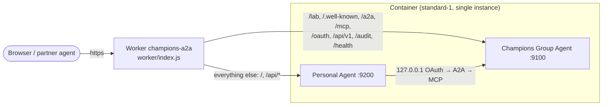

# Deployment (Cloudflare Workers + Containers)

The demo runs on Cloudflare as **one Worker in front of one Container**. The container image (`Dockerfile`) runs both agents, exactly as they run locally.



| Piece | File | Notes |
|---|---|---|
| Worker + Durable Object | `worker/index.js`, `worker/routes.js` | Starts the container on the first request, waits for both agents, then routes each path to its port |
| Container image | `Dockerfile`, `deploy/run.sh` | Python 3.12 slim, non-root user. Runs both uvicorn servers, and the container exits if either one dies |
| Configuration | `wrangler.jsonc` | Worker `champions-a2a`, `durable_object` scheduling policy, image built from the Dockerfile |

## Runtime settings

The Worker passes these to the container when it starts:

| Variable | Value |
|---|---|
| `CHAMPIONS_PUBLIC_URL` | The public origin of the first request, for example `https://champions-a2a.<subdomain>.workers.dev`. It appears in the Agent Card and is allowed by the MCP host check |
| `CHAMPIONS_URL` | `http://127.0.0.1:9100`. The Personal Agent reaches Champions inside the container |
| `CHAMPIONS_LAB_PASSWORD` | From the Worker secret `LAB_PASSWORD`. With it set, `/lab` requires HTTP Basic login (user `admin`). Without it, a hosted Lab fails closed and refuses everyone |
| `PERSONAL_AGENT_CLIENT_SECRET` | Optional Worker secret. If set, it overrides the demo client secret |

## Deploy from a machine

Requirements: Node.js 20+, Docker running, and the Workers Paid plan (needed for Containers).

```bash
npm install
npx wrangler login
npx wrangler secret put LAB_PASSWORD     # choose the Agent Lab password
npx wrangler deploy                      # builds the image, pushes it, deploys the Worker
```

The first deploy takes a few minutes while Cloudflare provisions the container. After that, the first request following an idle period (more than 15 minutes) cold-starts the container in about 10–30 seconds.

## Deploy automatically from GitHub (Workers Builds)

1. Cloudflare dashboard → **Workers & Pages** → **champions-a2a** → **Settings** → **Builds** → **Connect**.
2. Choose the GitHub repository `Champ-Deep/queryable-chatbot-` and branch `main`.
3. Leave the build command empty, set the deploy command to `npx wrangler deploy`, and the root directory to `/`.
4. Save. Every push to `main` now rebuilds the image and rolls out the container.

## Operating it

| Task | Command / place |
|---|---|
| Live logs | `npx wrangler tail`, or Dashboard → Workers & Pages → champions-a2a → Logs |
| Container status | `npx wrangler containers list`, or Dashboard → Workers & Pages → Containers |
| Change the Lab password | `npx wrangler secret put LAB_PASSWORD`. It applies on the next container start |
| Check health | `GET /health` (Champions) and `GET /api/health` (Personal Agent, also reports Champions) |

## Behaviour to be aware of

- **State is per container run.** The query log (SQLite), consents and audit live inside the container and reset when it sleeps after 15 idle minutes or restarts. Click **Run simulation** in the Lab to refill it. To keep data, mount R2 or store the log in a Durable Object (see the production notes in [MODEL.md](MODEL.md)).
- **Single instance.** All visitors share one container, which is right for a demo. The agents are stateless apart from the log and consents, so scaling out would mean moving that state into shared storage.
- **No outbound Internet.** The container starts with `enableInternet: false` because the agents only talk to each other.
- **Run locally with Docker.** `docker build -t champions-a2a . && docker run -p 9100:9100 -p 9200:9200 champions-a2a` behaves like the local `start` scripts.
