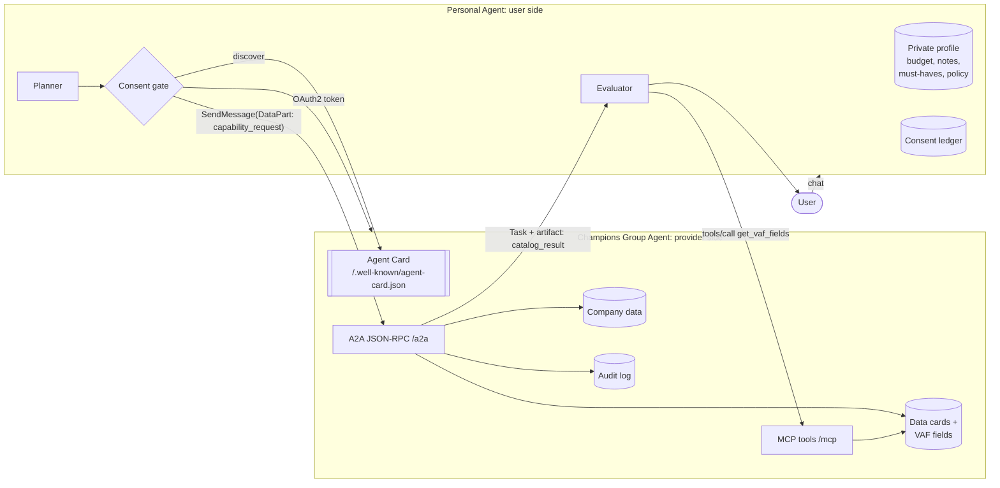
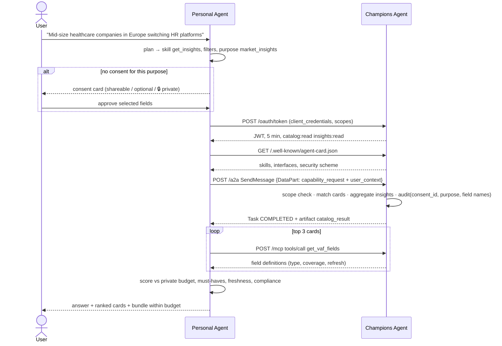

# Agent-to-Agent model: Champions Group Agent ⇄ User's Personal Agent

## 1. The model in one picture



**Responsibilities**

| Champions Group Agent | Personal Agent |
|---|---|
| Owns company data, the data-card catalog and VAF field definitions | Owns the user's profile, preferences, budget and consent |
| Explains capabilities (`describe_capabilities`) | Turns the user's question into a structured request |
| Matches cards and fields to a need (`find_data_cards`) | Shares only consented fields, for one stated purpose |
| Computes aggregate insights (`get_insights`) | Evaluates offers against private constraints |
| Never exports records or personal data over A2A | Recommends a bundle and explains why |
| Logs every exchange with its consent id and purpose | Shows the user every message it sent |

The split is the point: **the provider never sees the buyer's budget, notes or policy, and the buyer's agent never gets bulk data**. Each side keeps its own sensitive information and they exchange structured, minimal messages.

## 2. One turn, step by step



## 3. Protocols: what each one is for

| | **A2A (Agent2Agent)** | **MCP (Model Context Protocol)** | **Plain REST** |
|---|---|---|---|
| Purpose | One *agent* delegating a task to another *agent* | An agent calling *tools/data* exposed by a server | Any service-to-service call |
| Discovery | Agent Card at `/.well-known/agent-card.json`: skills, interfaces, auth schemes | `initialize` then `tools/list` with JSON Schemas | Out-of-band docs / OpenAPI |
| Unit of work | **Task** with lifecycle (`SUBMITTED → WORKING → COMPLETED / FAILED / INPUT_REQUIRED / AUTH_REQUIRED`), messages, artifacts | Single tool call → result | Endpoint call → response |
| Long-running / multi-turn | Built in (task ids, context ids, input-required, streaming, push notifications) | Not the focus | Hand-rolled |
| Opaque peer | Yes: the caller doesn't see the other agent's tools, prompts or data | No: the caller drives each tool | n/a |
| Used here for | Personal → Champions *"find me data for this need"* | Precise lookups of VAF field definitions; also usable by any MCP client (e.g. Claude) | OAuth token endpoint, audit view |

**Rule of thumb:** A2A is for when the other side should *think* (an opaque peer agent with its own data and logic). MCP is for when you want a *tool* you call deterministically. They complement each other: Champions offers both, so a buyer's agent can delegate with A2A and verify with MCP. REST stays useful for plumbing (tokens, health, audit).

Versions in this demo: **A2A 1.0** via `a2a-sdk` 1.3 (JSON-RPC binding, `A2A-Version: 1.0` header, method `SendMessage`) and **MCP** via `mcp` 2.3 over Streamable HTTP (stateless JSON mode, protocol `2025-06-18`).

## 4. JSON structures

All payloads carry a versioned `schema` id (`champions.<name>/v1`) and are defined once as Pydantic models in `common/schemas.py`.

**Request: A2A `SendMessage` (one DataPart)**
```json
{
  "jsonrpc": "2.0", "id": "…", "method": "SendMessage",
  "params": { "message": { "messageId": "…", "role": "ROLE_USER", "parts": [ { "data": {
    "schema": "champions.capability_request/v1",
    "skill": "get_insights",
    "need": "Find mid-size healthcare companies in Europe that are switching HR platforms",
    "filters": { "industries": ["Healthcare"], "regions": ["EMEA"], "size_bands": ["Mid-market"],
                 "countries": [], "intent_topics": ["HR Platform Replacement"] },
    "desired_outputs": ["intent_signals", "technographics"],
    "context": {
      "schema": "champions.user_context/v1",
      "consent_id": "cns-8538a81eff30",
      "purpose": "market_insights",
      "shared": { "industry": "HR Software", "role": "Head of Sales" }
    } } } ] } }
}
```

**Response: Task with a `catalog_result` artifact**
```json
{ "result": { "task": {
  "id": "…", "contextId": "…", "status": { "state": "TASK_STATE_COMPLETED" },
  "artifacts": [ { "name": "catalog_result", "parts": [ { "data": {
    "schema": "champions.catalog_result/v1",
    "matches": [ { "card_id": "intent_signals", "relevance": 1.0, "why": "Request mentions switching, topic filter",
                   "matched_fields": ["intent_topic", "intent_score", "surge_start"],
                   "coverage_pct": 61.8, "refresh": "daily", "credits_per_1k_records": 120,
                   "contains_personal_data": false } ],
    "matching_companies": 88,
    "insights": [ { "label": "Researching HR Platform Replacement", "value": 16,
                    "detail": "18.2% of the segment, average surge score 73" } ],
    "sample": [ { "company_name": "…", "hq_country": "Ireland", "size_band": "Mid-market",
                  "hr_platform": "ADP", "intent_topic": "HR Platform Replacement" } ],
    "method": "Keyword and filter match … No records exported.",
    "consent_id": "cns-8538a81eff30" } } ] } ] } } }
```

**MCP: `tools/call`**
```json
{ "jsonrpc": "2.0", "id": 2, "method": "tools/call",
  "params": { "name": "get_vaf_fields", "arguments": { "card_id": "intent_signals" } } }
```

**Personal Agent output: `recommendation/v1`** (stays on the user side)
```json
{ "schema": "champions.recommendation/v1",
  "summary": "Buy Intent Signals + Firmographics for about 520 credits/month (80 under your 600-credit budget).",
  "options": [ { "card_id": "intent_signals", "score": 87.6, "verdict": "recommended",
                 "est_monthly_credits": 480, "reasons": ["…"] } ],
  "bundle": ["intent_signals", "firmographics"], "bundle_monthly_credits": 520, "within_budget": true }
```

## 5. Authentication and authorization

- **Agent identity:** each partner agent is a registered OAuth2 client. The Personal Agent uses the **client-credentials** grant at `POST /oauth/token` and receives a **short-lived JWT** (5 minutes) with `iss`, `aud`, `sub`, `scope`, `exp` and `jti`.
- **Declared in the Agent Card:** `securitySchemes.bearer` (HTTP Bearer, JWT) plus a security requirement, so a client knows how to authenticate before its first call.
- **Enforced on every call:** middleware verifies signature, audience, issuer and expiry for `/a2a`, `/mcp` and `/audit` (401 + `WWW-Authenticate` otherwise).
- **Least privilege by scope:**

  | Scope | Allows |
  |---|---|
  | `catalog:read` | `describe_capabilities`, `find_data_cards`, MCP catalog tools |
  | `insights:read` | `get_insights` (A2A) and MCP `get_insights` |
  | `audit:read` | Read this client's own audit entries |
  | `contacts:read` | *Not granted to the demo client*: personal data needs a DPA |

- **Production upgrades:** asymmetric signing (RS256/ES256) with a JWKS endpoint; client authentication with `private_key_jwt` or mTLS instead of a shared secret; **OAuth 2.0 Token Exchange (RFC 8693)** when the Personal Agent acts *for a specific user*, so tokens carry both the agent and the user (`act` claim); signed Agent Cards; rate limits per client.

## 6. User consent and data privacy

- **Three sharing classes per profile field:** `shareable` (pre-ticked), `opt_in` (unticked: company name, target segment), `private` (locked: budget, must-have fields, compliance policy, notes). Private fields are rejected by the consent store even if requested.
- **Purpose-bound consent:** one consent per *(user, purpose)*: `data_discovery`, `market_insights`, `outreach`. Asking for contacts switches the purpose to `outreach` and triggers a new consent prompt.
- **Data minimisation:** only consented fields go into `user_context.shared`. Even search *filters* drawn from the user's stored target segment are used only if `target_segment` was consented; otherwise filters come from the question alone.
- **Consent receipt on the wire:** every request carries `consent_id` and `purpose`. Champions records them in its audit log with the *names* of shared fields, never their values.
- **Revocation:** revoking removes the consent; the next question asks again and nothing is sent until the user approves.
- **Provider-side protections:** no bulk export over A2A; only aggregates plus a 5-row sample without personal data; the Contacts card is described but never delivered over this channel; a GDPR-strict user is steered away from it by their own agent.
- **Transparency:** the user sees every outbound message (tokens and secrets redacted) and Champions' audit view of them.

## 7. Context sharing and structured user profiles

```json
{
  "industry": "HR Software",            "role": "Head of Sales",       "region": "EMEA",
  "goals": ["Build pipeline with companies replacing their HR platform"],
  "target_segment": { "industries": ["Healthcare"], "regions": ["EMEA"], "size_bands": ["Mid-market"] },
  "company_name": "PeopleFlow GmbH",
  "budget_monthly_credits": 600,        "must_have_fields": ["intent_score", "hr_platform", "employee_count"],
  "compliance": "gdpr_strict",          "freshness": "weekly",
  "private_notes": "…"
}
```

- The **profile lives with the Personal Agent**; Champions receives a *projection* of it (`user_context`) that is scoped to one purpose and versioned.
- Context is **flattened** for the wire (`target_segment.industries`), so a provider can't receive nested data it didn't ask for.
- The Personal Agent uses the **full** profile locally: it checks must-have fields against MCP field definitions, compares refresh rates to the needed freshness, and fits the bundle to the budget.

## 8. Evaluation logic (Personal Agent)

`score = 45·relevance + 15·coverage + 15·freshness fit + 15·affordable + 10·must-have coverage`

- `recommended` ≥ 62, `optional` ≥ 45. Personal-data cards are `not_recommended` for GDPR-strict users.
- The bundle takes recommended cards in score order while they fit the monthly budget. A card that doesn't fit is downgraded to `optional`, with the reason given.
- Monthly credits = price per 1k × max(segment, 1,000 minimum order) × deliveries per month.

## 9. Demo scope vs production

| Demo | Production |
|---|---|
| Rule-based planner and matcher (no LLM, works offline) | An LLM for need parsing and wording; the protocol and contracts stay the same |
| HS256 shared signing key, one registered client | IdP with JWKS, private_key_jwt or mTLS, token exchange for user delegation |
| In-memory consent ledger, task store and audit log | Durable stores; consent receipts (e.g. Kantara-style); tamper-evident audit |
| Synthetic catalog and companies | Real Champions catalog, coverage stats, pricing |
| Non-streaming A2A | Streaming and push notifications for long jobs (list builds, enrichment) |
| Both agents on localhost | Separate trust domains, TLS, signed Agent Cards, rate limiting |
